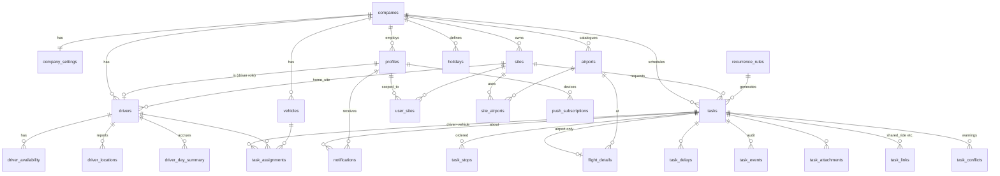

# Masar — Database Design (Supabase / Postgres)

The runnable source of truth is `supabase/migrations/0001_init.sql` (verified against Postgres 16 with a smoke test covering conflict detection, the task state machine, delays, location reporting, day summaries and idempotent offline replay). This document explains the design so Claude Code can extend it safely.

## 1. Principles
- **Tenant column everywhere**: every business row has `company_id`; RLS compares it to `auth_company_id()`.
- **State changes go through RPCs**, never through raw `update tasks set status`. `rpc_task_transition` validates the state machine, writes `task_events`, updates driver status and day summaries.
- **Client-generated event ids** (`task_events.id`) make driver actions idempotent so the offline queue can replay safely.
- **Bilingual columns** (`name` / `name_ar`) on reference data; free text is stored as typed.
- **No PostGIS dependency**: lat/lng doubles + `fn_distance_km()` haversine. Swap to PostGIS later if geofencing is needed.
- **Time**: everything `timestamptz`; the company `timezone` converts to local dates for day summaries and shift checks.

## 2. Entity-relationship overview



## 3. Tables

### Tenancy & people
| Table | Purpose | Key columns |
|---|---|---|
| `companies` | Tenant — created only by a platform super admin (0008) | `timezone`, `default_language`, `country_code` |
| `platform_admins` | Platform super admins (0008): outside every company, granted with SQL only | `user_id` |
| `company_settings` | All tunables (1:1) | `reminder_offsets_min int[]`, `grace_min`, `no_show_after_min`, `far_location_km`, `airport_share_window_min`, `standard_day_min`, `weekly_max_min`, `max_daily_driving_min`, `weekend_days int[]`, `offline_alert_after_min`, `location_interval_sec` |
| `profiles` | 1:1 with `auth.users`, created by trigger | `role app_role`, `language`, `notif_*` flags |
| `sites` | Construction sites / offices | `type site_type`, `lat/lng`, `google_place_id`, `work_start/end` |
| `user_sites` | Dispatcher → site scope (empty = all sites) | |

### Airports
| Table | Purpose |
|---|---|
| `airports` | Company-wide catalogue, unique `(company_id, iata)`; `source` = `ai`/`manual`/`google` |
| `site_airports` | Airports found for a site; `is_active` (0008: switched-off airports stay listed but are not offered when planning), `is_default` (always an active one), `distance_km`, `drive_minutes`, `default_buffer_min` |

### Staff & grades (0004)
| Table | Purpose |
|---|---|
| `grade_groups` | Per-company groups over grade ranges: `code` (A, B …), `rank` (1 = most senior), `min_grade`/`max_grade`, EN/AR names. Written only through `rpc_set_grade_groups` |
| `people` | Staff directory (Excel import or the wizard's "register" popup): `employee_no` (unique per company), names EN/AR, `grade`, job title, department, site, contacts. Drivers can't read it |

### Job titles & driver documents (0005)
| Table | Purpose |
|---|---|
| `document_types` | Company catalogue (passport, resident ID, licences, authorisation, insurance …): `has_expiry`, `remind_days` (reminder window), `is_active`. Country starter sets in `features/documents/presets.ts` |
| `job_titles` + `job_title_documents` | What each job needs to work legally; `drivers.job_title_id` puts those requirements on the driver (computed, not copied) |
| `driver_documents` | One current record per driver and type: `document_no`, `issued_on`, `expires_on` (required when the type expires), copy in the private `driver-documents` bucket (`company_id/driver_id/file`). Type deletes are restricted while drivers hold it |

### Drivers & vehicles
| Table | Purpose |
|---|---|
| `drivers` | HR-ish record; `profile_id` links the login; `home_site_id`; `shift_start/end`; `max_daily_driving_min` override; live `current_status` + `last_seen_at`; `grade` and `serve_group_id` = the most senior group they may drive (A = everyone) (0004) |
| `vehicles` | Plate, seats, odometer; `grade_group_id` = the one group it carries (0004) |
| `driver_availability` | Leave/off-day ranges → `driver_unavailable` conflicts |
| `driver_locations` | Append-only GPS pings (identity PK, pruned at 90 days). View `v_driver_latest_location` gives the last ping per driver for the live map |

### Tasks
| Table | Purpose |
|---|---|
| `tasks` | The unit of work. `category`, `status`, `priority`, `scheduled_start/end`, `estimated_*`, `actual_*`, `odometer_*`, `passengers jsonb`, `recurrence_rule_id` + `recurrence_date`, `remind_offsets_min` override, `conflicts_overridden` + `override_reason` |
| `task_stops` | Ordered legs; first stop is the origin. `leg_distance_km` / `leg_duration_min` from Distance Matrix; `actual_arrival_at` |
| `task_assignments` | Driver (+ vehicle). One `is_primary` per task (partial unique index). `acknowledged_at`, `declined_at`, `eta_next_stop_at` |
| `flight_details` | 1:1 for `airport` tasks: `direction`, `flight_no`, `scheduled_time`, `estimated_time` (after delays), `buffer_min`, `flight_status`, `provider_payload` |
| `task_delays` | Each **Delayed** press: `reason`, `delay_min`, `previous_status` (to resume), `new_estimated_start`, `resolved_at` |
| `task_events` | Immutable audit trail with GPS snapshot; client-generated `id` for idempotency |
| `task_attachments` | Storage paths for photos / signatures (bucket `task-attachments`, path `company_id/task_id/file`) |
| `task_links` | `shared_ride`, `return_trip`, `follow_up`, `duplicate_of` |
| `task_conflicts` | Materialised warnings, refreshed by triggers; `resolved_at` when superseded |
| `recurrence_rules` | RRULE + `generated_until` for daily routines |

### Notifications & hours
| Table | Purpose |
|---|---|
| `notifications` | In-app inbox + push queue. `channels[]`, `actions jsonb` (buttons), `scheduled_for`, `sent_at`, `read_at`, `acted_at` |
| `push_subscriptions` | Web Push endpoints per device |
| `holidays` | Company holidays → overtime rules |
| `driver_day_summary` | Per driver/day: `driving_min`, `working_min`, `overtime_min`, `distance_km`, `tasks_by_category` |
| `audit_log` | Optional generic audit for admin tables (wire triggers in a later migration) |

## 4. Task status machine (enforced in `rpc_task_transition`)

| Action | From | To | Side effects |
|---|---|---|---|
| (assignment insert) | draft/scheduled | assigned | `task_assigned` notification, `assigned` event, conflicts refreshed |
| `acknowledge` | assigned | acknowledged | `task_assignments.acknowledged_at` |
| `decline` | assigned | declined | `declined_at`, reason |
| `start` | assigned/acknowledged/delayed | en_route | `actual_start_at`, odometer, driver → `en_route` |
| `arrive` | en_route/delayed | in_progress | driver → `in_progress` |
| `delay` | assigned/acknowledged/en_route/in_progress | delayed | `task_delays` row; airport: `flight_details.estimated_time += delay_min`; reminders re-planned via `fn_task_effective_start` |
| `resume` | delayed | previous status | resolves open delay |
| `complete` | en_route/in_progress/delayed | completed | `actual_end_at`, distance/odometer, day summary refresh, driver → `idle` |
| `cancel` (staff) | any non-terminal | cancelled | reason |
| watchdog | assigned/acknowledged past `no_show_after_min` | no_show | event |

Call from the client:
```ts
const { data, error } = await supabase.rpc('rpc_task_transition', {
  p_task_id: taskId,
  p_action: 'delay',
  p_payload: { reason: 'flight_delayed', delay_min: 40, lat, lng, client_ts: new Date().toISOString() },
  p_event_id: crypto.randomUUID(),   // store in IndexedDB queue; replay is idempotent
});
```

## 5. Functions & RPC contracts

| Function | Called by | Returns |
|---|---|---|
| `fn_check_task_conflicts(task, driver, vehicle?, start?, end?)` | triggers, existing tasks | rows `(type, severity, other_task_id, details)`; delegates to `fn_conflicts_for` (0003) |
| `rpc_preview_task_conflicts(driver_ids[], start, end, vehicle?, first_lat?, first_lng?, exclude_task?)` | Task wizard AssignStep, before the task exists (US-03) | rows `(driver_id, type, severity, other_task_id, details)`; `driver_id` null = vehicle conflict |
| `rpc_save_task(p_task jsonb)` | Task wizard (create + edit) | task id. One transaction: task, stops (replaced), flight, primary assignment, then the conflict gate. Payload in 0003 §3 / `SaveTaskPayload` |
| `rpc_reschedule_task(task, start, driver?, change_driver?, override_reason?)` | Calendar drag-and-drop (US-14) | void. Shifts times + stop arrivals; optional reassignment; re-runs the gate |
| `rpc_override_task_conflicts(task, reason)` | Task sheet, owner/admin | void. FR-14 override, audited as `conflict_overridden` |
| `rpc_set_grade_groups(groups jsonb)` | Settings → Grades (owner/admin) | the saved groups. Ordered list (first = A); refuses overlaps / bad ranges / duplicate codes; codes that survive keep their id |
| `rpc_import_people(rows jsonb)` | Staff → Import from Excel (staff) | `{inserted, updated}`. Upsert by `employee_no`; `site` matched by code or name |
| `rpc_preview_grade_conflicts(passengers, vehicle?, driver?)` | Wizard preview (the web app also computes it client-side, `features/grades/rules.ts`) | conflict rows |
| `fn_snapshot_passengers(company, passengers)` | `rpc_save_task` | passengers with directory grade + group stamped; visitors keep their trip group; free text can't claim one |
| `rpc_share_trip(task, host_task)` | Wizard / task sheet / dashboard hint (FR-15) | void. `task_links` shared_ride, passengers + the rider's site stop copied to the host; riders follow the host (`trg_shared_ride_follow`) |
| `fn_refresh_task_conflicts(task)` | triggers on `task_assignments` and time changes on `tasks` | persists into `task_conflicts` |
| `fn_similar_airport_trips(airport, time, exclude_task?)` | Task wizard (assign step), task sheet, dashboard | other sites' trips within `airport_share_window_min` (riders excluded since 0003) |
| `rpc_task_transition(task, action, payload, event_id)` | Driver PWA / dispatcher | updated `tasks` row |
| `rpc_report_location(lat, lng, accuracy?, speed?, heading?, battery?, task?, recorded_at?)` | Driver PWA every 30 s | void |
| `fn_refresh_driver_day_summary(driver, date)` | on complete; nightly job | upserts summary |
| `fn_plan_due_reminders()` | pg_cron every minute | count of reminders queued |
| `fn_task_watchdog()` | pg_cron every minute | start/complete prompts, dispatcher alerts, auto no-show, offline drivers |
| `fn_prune_locations()` | pg_cron daily | deletes > 90 days |
| `fn_document_reminders()` | pg_cron daily (`masar-documents`) | count of notifications. `document_expiring` when a document enters its type's `remind_days` window and again ≤ 7 days, `document_expired` once it lapses — to the company's owners/admins, deduped on (document, stage, expiry date). `data` carries `driver_id` so the bell opens the driver |
| `rpc_save_job_title(title jsonb)` | Settings → Documents (owner/admin) | job title id; saves the title and replaces its required document types |
| `fn_task_effective_start/end(task)` | internal | start/end considering open delays |
| `auth_company_id() / auth_role() / auth_driver_id() / auth_is_staff() / auth_is_admin() / auth_can_access_site()` | RLS | security-definer helpers |

## 6. RLS matrix

| Table | owner/admin | dispatcher | driver | viewer |
|---|---|---|---|---|
| companies, company_settings | R/W (create: super admin only, 0008) | R | R | R |
| profiles | R/W company | R company, W self | R company, W self | R company |
| sites, holidays | R/W | R | R | R |
| user_sites | R/W | R own | – | – |
| airports, site_airports, vehicles, recurrence_rules | R/W | R/W | R | R |
| drivers | R/W | R | R, W self | R |
| driver_availability | R/W | R/W | R | R |
| driver_locations | R | R | insert own, R | R |
| tasks | R/W all | R/W scoped sites | R assigned only | R all |
| task_* children | via `auth_can_see_task` / `auth_can_edit_task` | same | see assigned; insert events/delays/attachments; update stops (actual arrival) | see |
| task_conflicts | R, update (override) | R, update | R | R |
| notifications, push_subscriptions | own | own | own | own |
| driver_day_summary | R | R | R own | R |
| audit_log | R | – | – | – |

Service role (Edge Functions) bypasses RLS for push delivery, ETA refresh and report exports.

**Platform super admin (0008)** has no company: reads/updates every `companies` row and calls `rpc_platform_*`, but every company-scoped policy keys off `auth_company_id()`, so they see no sites, tasks, drivers or people.

## 7. Realtime channels (client)
```ts
supabase.channel('dispatch')
  .on('postgres_changes', { event: '*', schema: 'public', table: 'tasks', filter: `company_id=eq.${companyId}` }, refetchCalendar)
  .on('postgres_changes', { event: 'INSERT', schema: 'public', table: 'driver_locations', filter: `company_id=eq.${companyId}` }, moveMarker)
  .on('postgres_changes', { event: 'INSERT', schema: 'public', table: 'notifications', filter: `user_id=eq.${userId}` }, toast)
  .subscribe();
```

## 8. Edge Functions (Deno) — contracts
| Function | Trigger | Input → Output |
|---|---|---|
| `ai-suggest-airports` ✅ | POST from site sheet / onboarding (staff only) | `{lat,lng,country_code?,lang?}` → `{airports:[{iata,icao,name,name_ar,city,city_ar,country_code,lat,lng,distance_km,drive_minutes,is_international,source,drive_estimated}]}` ≤ 8. Places Text Search (~300 km box) → Claude (`claude-opus-5-5`, structured JSON output, server-side refusal fallback) normalises; no Places key → Claude lists airports from knowledge; Distance Matrix or haversine × 1.3 estimate. Secrets: `ANTHROPIC_API_KEY`, optional `GOOGLE_MAPS_SERVER_KEY`. Contract in `supabase/functions/_shared/schemas.ts` (shared with the web app as `@shared/schemas`). |
| `invite-user` ✅ | POST from Settings → Users / onboarding (owner/admin) | `{email, full_name, full_name_ar?, role ∈ admin·dispatcher·driver·viewer, language, phone?, site_ids[], driver_id?, home_site_id?}` → `{user_id, driver_id}`. `auth.admin.inviteUserByEmail` (link → `/accept-invite`), then attaches the profile to the caller's company with the role, writes `user_sites`, and creates or links the `drivers` row. Errors return `{code}` i18n keys (`users.errors.*`). Secret: `SITE_URL`. |
| `invite-owner` ✅ | POST from the super admin console `/platform` (platform super admin only, 0008) | `{company_id, email, full_name, language}` → `{user_id, existing}`. Invites the company's owner (`auth.admin.inviteUserByEmail`, link → `/accept-invite?next=/onboarding`) and attaches the profile as `owner`; an existing account without a company is attached directly (`existing: true`). 409 `platform.errors.ownerInCompany` / `ownerIsPlatformAdmin`, 404 `unknownCompany`. Secret: `SITE_URL`. |
| `ai-parse-ticket` ✅ | POST from the task wizard flight card (staff only) | `{media_type (pdf/jpeg/png/webp), data (base64, ≤ 8 MB raw), file_name?}` → `{booking_ref, issuer, passengers:[{name,ticket_no}], segments:[{flight_no,airline,from_iata,from_name,to_iata,to_name,departure_date,departure_time,arrival_date,arrival_time,departure_terminal,arrival_terminal,uncertain[]}]}` (FR-18). Claude (`claude-opus-5-5`, effort high, PDF / image input, structured JSON output, server-side refusal fallback) reads any agency's layout; both ends of every flight, IATA codes inferred from printed airport / city names (flagged uncertain); times are local at each airport as printed; the function normalises flight numbers / IATA codes / dates and flags anything malformed or missing in `uncertain`. 422 `notATicket` / `noFlights` / `unreadable`. Nothing is stored. Prompt, schema and clean-up in `_shared/ticket-reader.ts` (the web dev server uses the same file in demo mode). The web app maps segments to the company's airports, matches passenger names to `people` (others become one-time visitors), and saves the far end of the flight + booking in `tasks.metadata.ticket` = `{other:{iata,name,date,time,terminal}, booking_ref, issuer, tickets:[{name,ticket_no}]}` (other = origin of an arrival, destination of a departure). Secret: `ANTHROPIC_API_KEY`. Contract in `_shared/schemas.ts`. |
| `route-estimate` ✅ | POST from the task wizard (staff only) | `{stops:[{lat,lng}] (2…10), departure_time?}` → `{legs:[{distance_km,duration_min}], distance_km, duration_min, estimated}`. One Distance Matrix call (diagonal = legs), traffic-aware for a future departure; no key / failure → haversine × 1.3 @ 70 km/h with `estimated: true`. Real answers cached per isolate for 10 min by (stops, 15-min departure bucket). The web app falls back to the same estimate if the function is unreachable. Contract in `_shared/schemas.ts`. Secret: optional `GOOGLE_MAPS_SERVER_KEY`. |
| `eta-refresh` | pg_cron every 5 min (via pg_net) | recompute `task_assignments.eta_next_stop_at` for active tasks |
| `send-push` | pg_cron every minute or DB webhook on `notifications` insert | delivers Web Push for rows where `sent_at is null and 'push' = any(channels)`; localises by `profiles.language`; marks `sent_at` |
| `flight-status` (opt) | pg_cron every 10 min | update `flight_details.flight_status/estimated_time` from provider |
| `reports-export` | POST | `{from,to,driver_ids?,site_ids?,format:'csv'|'xlsx'}` → signed Storage URL |
| `ai-assist` (v1.1) | POST | natural language → draft task JSON |
| `recurrence-generate` | pg_cron nightly | expand RRULEs 14 days ahead |

## 9. Seed / local dev
```bash
supabase start
supabase db reset          # applies 0001_init.sql
# enable pg_cron + pg_net in dashboard for hosted project, then run section 15 of the migration
```
`supabase/seed.sql` (verified against `0001_init.sql` on Postgres 17): one company, four sites (Riyadh HQ, Al Yasmin, Dammam, Jeddah Tower), airports RUH/DMM/JED, four drivers with logins, four vehicles, today's board mirroring `design/preview.html` (delayed SV 1234, Yousef double-booked and over hours, Khalid unacknowledged, two same-day RUH trips from different sites → share hint), tomorrow's open work, and ~13 days of completed history for reports. Status changes go through `rpc_task_transition` by impersonating each driver (`request.jwt.claims`). All logins use password `Masar!2026`: `super@` (platform super admin, no company — 0008), `owner@`, `dispatcher@`, `dammam@`, `viewer@`, `ahmed@`, `khalid@`, `yousef@`, `fahad@masar.dev`.

## 9a. Migration 0002 — Phase 1 setup & security fixes
| Change | Why |
|---|---|
| `trg_profiles_guard` (before update on `profiles`) | `profiles_update_self` let a user change their **own** `role` / `company_id` (self-promotion, tenant hopping). Now only an admin of the same company may change another user's role/company/active flag; nobody changes their own; only owners grant/revoke `owner`. |
| `trg_drivers_guard` (before update on `drivers`) | `drivers_self_update` allowed any column. Drivers may now change only `phone` / `photo_url`. |
| `user_sites` policies rewritten + `auth_user_in_company()` | `user_sites_admin` had no company check. |
| `companies_insert` dropped → `rpc_create_company(name, name_ar?, country_code?, timezone?, default_language?)` | Onboarding (FR-01): creates company + settings and makes the caller owner, once. Validates the time zone. **Dropped in 0008** → `rpc_platform_create_company`. |
| `rpc_set_site_airports(site_id, airports jsonb)` | FR-03: upserts the company airport catalogue by IATA, replaces the site's links, keeps exactly one default. Security invoker (RLS applies). |
| `rpc_task_transition` | Driver live status is now derived from the driver's most active open task (previously acknowledging a later trip reset an en-route/delayed driver to `idle`). |

The guards key off `current_user`: client DML runs as `authenticated`, while `SECURITY DEFINER` RPCs, `service_role` Edge Functions and migrations are trusted. Covered by `supabase/tests/0002_security.test.sql` (pgTAP, 27 assertions; 14 of them fail against 0001 alone).

## 9b. Migration 0003 — Phase 2 tasks core
| Change | Why |
|---|---|
| `fn_conflicts_for(company, driver?, vehicle?, start, end, first_lat?, first_lng?, exclude_task?)` | The conflict engine for a *proposed* task, so the wizard warns before saving (US-03). Same six checks as 0001, but the same-day checks (multi-location, over hours) use **company-local** days — 0001 used UTC days, so a 01:30 Riyadh trip counted toward the previous day. Execute is revoked from clients, and it refuses a foreign company even if reached. |
| `fn_check_task_conflicts` | Now delegates to the engine and refuses another tenant's task (it is security definer and was callable with any task id, leaking that company's schedule). |
| `rpc_preview_task_conflicts` | All candidate drivers in one call for the AssignStep list (FR-16). |
| `rpc_save_task` + `fn_set_primary_driver` + `fn_conflict_gate` | Atomic wizard write. The gate re-materialises `task_conflicts` for the task **and every task it collides with** (0001 only refreshed the edited side), then enforces FR-14: blocking conflicts → `conflicts.errors.blocking` without a reason, `conflicts.errors.adminOnly` for non-admins; an admin's override sets `conflicts_overridden / override_reason / override_by`. Edits are allowed while `draft / scheduled / assigned / acknowledged / declined`. Errors are i18n keys. |
| `rpc_reschedule_task`, `rpc_override_task_conflicts` | Calendar moves (US-14) and the task sheet's override (FR-14). |
| `rpc_share_trip`, `trg_shared_ride_follow` | FR-15. The rider keeps its own row (site reporting) with `metadata.shared_with = host` and no assignment; the host gets the passengers and a stop at the rider's site (after the airport for arrivals, before it for departures). Riders complete with their host and are released (unlinked) if it is cancelled or a no-show. Security definer because sharing is cross-site, so access is checked explicitly: the caller can edit the rider; the host is open, in the same company and going to the same airport. |
| `fn_similar_airport_trips` | Excludes riders — they have no car to share. |

Server-side status changes in 0003 (unassign → `scheduled`, riders following the host) are consequences of a staff write, like `trg_notify_assignment`; drivers still change status only through `rpc_task_transition`. Demo mode mirrors all of it in `apps/web/src/mocks/task-writes.ts` (keep in sync). Covered by `supabase/tests/0003_tasks.test.sql` (pgTAP, 32 assertions).

## 9c. Migration 0004 — staff, grades and grade groups
Company rule: one grade group per car, and it is the car's group. Passengers in `tasks.passengers` are `{person_id?, name, phone?, grade?, group_id?, group_code?, visitor?}`, stamped by `fn_snapshot_passengers` at save time (grades come from the directory, never from the client). Three blocking conflict types join the FR-14 gate, so the same admin override applies:

| Conflict | When |
|---|---|
| `grade_mixed` | passengers from more than one group |
| `vehicle_grade_mismatch` | the car's `grade_group_id` isn't the passengers' group |
| `driver_grade_not_allowed` | a passenger's group is more senior than the driver's `serve_group_id` |

`fn_refresh_task_conflicts` adds them once per task (with the primary assignment's car and driver), and a passengers-changed trigger re-checks. Shared rides (FR-15) only merge within one group (`trg_task_links_grade` → `share.errors.gradeMismatch`); `fn_similar_airport_trips` now also returns `passenger_groups` and `vehicle_group`. With no groups configured, nobody has a group and no grade conflict is raised. Demo mode mirrors this in `features/grades/rules.ts` + `mocks/task-writes.ts`. pgTAP: `supabase/tests/0004_grades.test.sql` (24 assertions).

Note: a car is stored on the driver assignment, so a task without a driver has no car (the wizard disables the car until a driver is picked).

## 9d. Migration 0005 — job titles, driver documents and renewals
RLS: catalogue and job titles readable by the company, writable by owner/admin. `driver_documents` rows are readable by staff and viewers (status) and by the driver themself; written by owner/admin. **Copies** (bucket `driver-documents`) are readable only by owner/admin and the driver whose folder it is (NFR-01 PII). `trg_driver_documents_check` keeps driver, type and company consistent and requires the expiry date for expiring types. Status (`missing / expired / expiring / valid`) is computed in the app (`features/documents/status.ts`) with the same windows the reminder job uses. Schedule after deploy:
```sql
select cron.schedule('masar-documents', '0 3 * * *', $$select fn_document_reminders()$$);
```
pgTAP: `supabase/tests/0005_documents.test.sql` (16 assertions).

## 9e. Migration 0006 — Passenger module, phase 1
Passengers are directory people (`people`) with a login: role **`passenger`**, `people.profile_id`, `registration_status` (pending / approved / rejected). Roles: Fleet Manager/Owner = `owner`, Company Admin = `admin`.

| Object | Purpose |
|---|---|
| Restrictive policies `*_no_passengers` (+ `profiles_passenger_self`, `people_passenger_self`) | Passengers can't read any staff table; they AND with the existing permissive policies, so no earlier policy changed. Storage: passengers open only `task-attachments` copies marked `visible_to_passengers` on their own trips (`fn_passenger_can_read_attachment`) |
| `rpc_passenger_register(full_name, phone?, employee_no?, join_code?, language?)` | After Supabase sign-up: company by e-mail domain (`company_settings.passenger_email_domains`) or join code + employee ID (`passenger_join_code`); links/creates the person, **pending**, notifies owners/admins (`passenger_registered`) |
| `rpc_review_registration(person, approve, note?)` | Owner/admin; notifies the passenger (`registration_approved` / `registration_rejected`), audited |
| `rpc_passenger_home()` | The passenger's trips as JSON — ticket (flight), stops, duration, driver card (nationality, licence type from `document_types.is_driving_licence`, `english_rating`, `fn_driver_rating`), vehicle, co-passengers (first name + pickup order), passenger-visible documents, own rating. **No driver phone**; `contact_phone` = the site's dispatch line only during the active trip window. Pending/rejected → status only |
| `rpc_update_my_profile(jsonb)` | Phone, language, accessibility needs, ride preferences, photo — never grade/company |
| `task_passengers` | Indexed trip ↔ person link (visitors: `person_id` null), rebuilt from `tasks.passengers` by trigger; pickup order + check-in fields for phase 2 |
| `task_attachments` + `title, category, expires_on, visible_to_passengers, file_*` | Trip documents (hotel booking, gate pass, flight ticket, visa, other); `storage_path` may be empty until a copy is uploaded |
| `rating_options` | Company data, seeded EN/AR for every company (`fn_seed_rating_options`, trigger on `companies`): categories driving / trip / road (one answer) and cleanliness / vehicle (any); `score` feeds the driving-behaviour rating, `alerts` flags phone use / safety concern |
| `trip_ratings` + `trip_rating_choices`, bucket `rating-photos` | One rating per passenger per trip (`rpc_submit_rating`), completed trips only, editable for `rating_edit_hours` (24). Low when stars ≤ `low_rating_threshold` (2) or an `alerts` option → `low_rating` notification to owners/admins (once per rating). Rows visible to owners/admins and the rater only — drivers and dispatchers see `fn_driver_rating` averages |
| `emergency_contacts`, `drivers.nationality`, `drivers.english_rating` | Passenger profile; driver card |

pgTAP: `supabase/tests/0006_passengers.test.sql` (37 assertions). Demo mirror: `mocks/passenger.ts`.

## 9f. Migration 0007 — Passenger module, phase 2
Live tracking, share links, passenger notifications, pickup check-in, SOS, trip requests. Also fixes the 0001 `tasks_select` policy (`a.task_id = id` bound to `task_assignments.id`, so drivers could not read their own tasks from the table).

| Object | Purpose |
|---|---|
| `fn_notify_passengers` + triggers | Approved passengers with a login hear about their trip: `passenger_trip_assigned` (added to an upcoming trip, from `fn_sync_task_passengers`), `driver_changed` (a different primary driver), `driver_on_the_way` (→ en_route), `driver_arrived` (→ in_progress), `task_delayed`, `task_cancelled`, `task_completed`, `trip_document_added` (a document marked for passengers). `data.audience = 'passenger'`. Channels `{in_app,push}` |
| `fn_trip_is_live(task)` | Acknowledged → under way and within 2 h of the plan (or the delayed start). Gates the live map, SOS and the dispatch line in `rpc_passenger_home` |
| `rpc_passenger_live(task)` | Own trips only: driver's last position (< 30 min old, only while live), next stop (pickup — the airport for an arrival — until checked in, then the last stop), distance and ETA (haversine × 1.3 at 40 km/h to *that* stop) |
| `trip_share_links`, `rpc_create_share_link(task)`, `rpc_revoke_share_link(task)`, `rpc_shared_trip(token)` | 64-hex random token, one live link per passenger per trip, expires 3 h after the trip and immediately when it is completed / cancelled. `rpc_shared_trip` is granted to **anon**: state (`active` / `ended` / `invalid`), live payload, company, driver first name, vehicle, destination — no names of passengers, no phone numbers |
| `task_passengers.checkin_code` | Six digits per passenger per trip (unique within the trip). **Column privileges**: `authenticated` can select every column except `checkin_code`, so drivers never see codes; passengers get theirs from `rpc_passenger_home().trips[].checkin` until checked in |
| `rpc_driver_check_in(task, code, lat?, lng?, task_passenger_id?)` → `{ok, error?, name, pickup_order, status}` | Primary driver only; trip under way or within 2 h of the plan. Wrong codes are logged (`audit_log.action = 'checkin_failed'`); 5 in 10 min lock check-in (`checkin.errors.locked`). The first check-in starts the trip (`start` + `arrive` via `rpc_task_transition`). `task_passenger_id` without a code only for riders without an approved login (visitors) — otherwise `checkin.errors.codeRequired`. Audited (`checked_in`, method code / no_app) |
| `rpc_driver_drop_off(task_passenger)` → `{ok, completed}` | Stamps `dropped_off_at` (audited); when everyone was picked up and dropped off the trip completes. Completing / cancelling a trip drops off whoever is still on board |
| `sos_events`, `rpc_passenger_sos(task, lat?, lng?, accuracy?, message?)` → `{id, emergency_contacts, dispatch_phone}` | Live trip, or on board and not dropped off. One open event per passenger per trip (pressing again refreshes the position). Notifies owners/admins + the site's dispatchers (`sos_alert`, `fn_notify_site_staff`). Audited (`sos_raised`). Readable by the passenger and staff/viewers who can see the trip — not drivers |
| `rpc_sos_update(sos, 'acknowledge' \| 'resolve', note?)` | Staff of the trip's site; audited |
| `trip_requests`, `rpc_passenger_request(jsonb)` | Approved passengers: `kind` new (requested_start in the future, pickup, dropoff, passengers_count 1–20) / reschedule (own trip, not started, new time) / cancel (own trip, not started); notes ≤ 1000; one pending request per trip. Routed by site (the trip's, else the person's) to owners/admins + site dispatchers (`trip_request`). No insert / update policies — RPCs only |
| `rpc_withdraw_request(id)` | The passenger, while pending |
| `rpc_decide_request(id, approve, note?, created_task_id?, override_reason?)` | Staff of the site. Rejecting needs a note. Approving a reschedule runs `rpc_reschedule_task` (conflict gate — `override_reason` for admins); a cancel removes the passenger from `tasks.passengers`, or cancels the trip when they ride alone; a new trip links `created_task_id` (planned in the wizard). Notifies the passenger (`trip_request_decided`), audited |

Realtime: `sos_events`, `trip_requests` are in `supabase_realtime`.

**Web Push.** The app stores `push_subscriptions` (own rows, RLS) from the profile toggle (`VITE_VAPID_PUBLIC_KEY`); the service worker (`public/push-sw.js`) shows them. Edge Function `send-push` sends queued rows (`sent_at is null`, `'push' = any(channels)`) to every subscription of the recipient (respecting `profiles.notif_push`), localised by `profiles.language`, then stamps `sent_at` and deletes gone endpoints. Secrets: `VAPID_PUBLIC_KEY`, `VAPID_PRIVATE_KEY`, `VAPID_SUBJECT`, `PUSH_CRON_SECRET`. Schedule it (pg_cron + pg_net, once per project):

```sql
select cron.schedule('masar-send-push', '* * * * *', $$
  select net.http_post(
    url     := 'https://<project-ref>.supabase.co/functions/v1/send-push',
    headers := jsonb_build_object('Content-Type', 'application/json',
                                  'Authorization', 'Bearer <anon key>',
                                  'x-cron-secret', '<PUSH_CRON_SECRET>'),
    body    := '{}'::jsonb)
$$);
```

pgTAP: `supabase/tests/0007_passenger_phase2.test.sql` (58 assertions). Demo mirror: `mocks/passenger-trips.ts`.

## 9g. Migration 0008 — platform super admin, active site airports
| Object | Purpose |
|---|---|
| `platform_admins (user_id)` + `auth_is_platform_admin()` | Platform super admins; RLS lets a user read only their own row, nobody can insert through the API. Grant with SQL: `insert into platform_admins (user_id) values ('<auth user id>');` |
| `rpc_platform_create_company(name, name_ar?, country_code?, timezone?, default_language?)` | FR-01: super admin only (42501 otherwise); creates company + settings; validates name, two-letter country, time zone. The self-service `rpc_create_company` is dropped — signing up no longer creates a tenant. |
| `rpc_platform_companies()` | Super admin console: every company with its first owner (`owner_pending` = invited, never signed in), site and user counts. No company data. |
| policies `companies_platform_select/update` | Super admin reads and edits company profiles. |
| `site_airports.is_active` + `rpc_set_site_airports` | Items take `is_active` (default true). Inactive rows are kept but never default; the default is the first active row flagged `is_default`, else the first active row; all off → no default. The app plans trips with active airports only. |

Flow: super admin creates the company and names the owner (`/platform`) → `invite-owner` e-mails them → `/accept-invite` → `/onboarding` (confirm profile → first site with MapPicker → AI airports with Active switches → invite team). Accounts with no company land on `/no-company`.

pgTAP: `supabase/tests/0008_platform.test.sql` (20 assertions); `0002_security.test.sql` §4 now creates the second company as the super admin. Demo mirror: `features/platform/queries.ts` (`mockDb.platformAdmins`, `mockDb.otherCompanies`), `features/sites/airports.ts`.

## 10. Future migrations (not in 0001)
- `0002_audit_triggers.sql` — generic audit trigger on admin tables.
- `0003_geofences.sql` — PostGIS, site geofences, route deviation alerts.
- `0004_maintenance.sql` — vehicle service, fuel logs.
