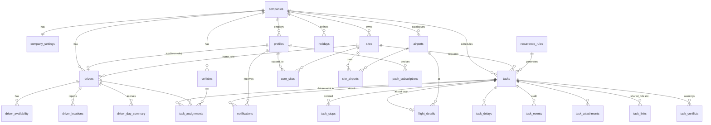

# Masar — Database Design (Supabase / Postgres)

The runnable source of truth is `supabase/migrations/0001_init.sql` (verified against Postgres 16 with a smoke test covering conflict detection, the task state machine, delays, location reporting, day summaries and idempotent offline replay). This document explains the design so Claude Code can extend it safely.

## 1. Principles
- **Tenant column everywhere**: every business row has `company_id`; RLS compares it to `auth_company_id()`.
- **State changes go through RPCs**, never through raw `update tasks set status`. `rpc_task_transition` validates the state machine, writes `task_events`, updates driver status and day summaries.
- **Client-generated event ids** (`task_events.id`) make driver actions idempotent so the offline queue can replay safely.
- **Bilingual columns** (`name` / `name_ar`) on reference data; free text is stored as typed.
- **No PostGIS dependency**: lat/lng doubles + `fn_distance_km()` haversine. Swap to PostGIS later if geofencing is needed.
- **Time**: everything `timestamptz`; the company `timezone` converts to local dates for day summaries and shift checks.

## 2. Entity-relationship overview



## 3. Tables

### Tenancy & people
| Table | Purpose | Key columns |
|---|---|---|
| `companies` | Tenant | `timezone`, `default_language`, `country_code` |
| `company_settings` | All tunables (1:1) | `reminder_offsets_min int[]`, `grace_min`, `no_show_after_min`, `far_location_km`, `airport_share_window_min`, `standard_day_min`, `weekly_max_min`, `max_daily_driving_min`, `weekend_days int[]`, `offline_alert_after_min`, `location_interval_sec` |
| `profiles` | 1:1 with `auth.users`, created by trigger | `role app_role`, `language`, `notif_*` flags |
| `sites` | Construction sites / offices | `type site_type`, `lat/lng`, `google_place_id`, `work_start/end` |
| `user_sites` | Dispatcher → site scope (empty = all sites) | |

### Airports
| Table | Purpose |
|---|---|
| `airports` | Company-wide catalogue, unique `(company_id, iata)`; `source` = `ai`/`manual`/`google` |
| `site_airports` | Which airports a site uses; `is_default`, `distance_km`, `drive_minutes`, `default_buffer_min` |

### Drivers & vehicles
| Table | Purpose |
|---|---|
| `drivers` | HR-ish record; `profile_id` links the login; `home_site_id`; `shift_start/end`; `max_daily_driving_min` override; live `current_status` + `last_seen_at` |
| `vehicles` | Plate, seats, odometer |
| `driver_availability` | Leave/off-day ranges → `driver_unavailable` conflicts |
| `driver_locations` | Append-only GPS pings (identity PK, pruned at 90 days). View `v_driver_latest_location` gives the last ping per driver for the live map |

### Tasks
| Table | Purpose |
|---|---|
| `tasks` | The unit of work. `category`, `status`, `priority`, `scheduled_start/end`, `estimated_*`, `actual_*`, `odometer_*`, `passengers jsonb`, `recurrence_rule_id` + `recurrence_date`, `remind_offsets_min` override, `conflicts_overridden` + `override_reason` |
| `task_stops` | Ordered legs; first stop is the origin. `leg_distance_km` / `leg_duration_min` from Distance Matrix; `actual_arrival_at` |
| `task_assignments` | Driver (+ vehicle). One `is_primary` per task (partial unique index). `acknowledged_at`, `declined_at`, `eta_next_stop_at` |
| `flight_details` | 1:1 for `airport` tasks: `direction`, `flight_no`, `scheduled_time`, `estimated_time` (after delays), `buffer_min`, `flight_status`, `provider_payload` |
| `task_delays` | Each **Delayed** press: `reason`, `delay_min`, `previous_status` (to resume), `new_estimated_start`, `resolved_at` |
| `task_events` | Immutable audit trail with GPS snapshot; client-generated `id` for idempotency |
| `task_attachments` | Storage paths for photos / signatures (bucket `task-attachments`, path `company_id/task_id/file`) |
| `task_links` | `shared_ride`, `return_trip`, `follow_up`, `duplicate_of` |
| `task_conflicts` | Materialised warnings, refreshed by triggers; `resolved_at` when superseded |
| `recurrence_rules` | RRULE + `generated_until` for daily routines |

### Notifications & hours
| Table | Purpose |
|---|---|
| `notifications` | In-app inbox + push queue. `channels[]`, `actions jsonb` (buttons), `scheduled_for`, `sent_at`, `read_at`, `acted_at` |
| `push_subscriptions` | Web Push endpoints per device |
| `holidays` | Company holidays → overtime rules |
| `driver_day_summary` | Per driver/day: `driving_min`, `working_min`, `overtime_min`, `distance_km`, `tasks_by_category` |
| `audit_log` | Optional generic audit for admin tables (wire triggers in a later migration) |

## 4. Task status machine (enforced in `rpc_task_transition`)

| Action | From | To | Side effects |
|---|---|---|---|
| (assignment insert) | draft/scheduled | assigned | `task_assigned` notification, `assigned` event, conflicts refreshed |
| `acknowledge` | assigned | acknowledged | `task_assignments.acknowledged_at` |
| `decline` | assigned | declined | `declined_at`, reason |
| `start` | assigned/acknowledged/delayed | en_route | `actual_start_at`, odometer, driver → `en_route` |
| `arrive` | en_route/delayed | in_progress | driver → `in_progress` |
| `delay` | assigned/acknowledged/en_route/in_progress | delayed | `task_delays` row; airport: `flight_details.estimated_time += delay_min`; reminders re-planned via `fn_task_effective_start` |
| `resume` | delayed | previous status | resolves open delay |
| `complete` | en_route/in_progress/delayed | completed | `actual_end_at`, distance/odometer, day summary refresh, driver → `idle` |
| `cancel` (staff) | any non-terminal | cancelled | reason |
| watchdog | assigned/acknowledged past `no_show_after_min` | no_show | event |

Call from the client:
```ts
const { data, error } = await supabase.rpc('rpc_task_transition', {
  p_task_id: taskId,
  p_action: 'delay',
  p_payload: { reason: 'flight_delayed', delay_min: 40, lat, lng, client_ts: new Date().toISOString() },
  p_event_id: crypto.randomUUID(),   // store in IndexedDB queue; replay is idempotent
});
```

## 5. Functions & RPC contracts

| Function | Called by | Returns |
|---|---|---|
| `fn_check_task_conflicts(task, driver, vehicle?, start?, end?)` | UI before save (`supabase.rpc`), triggers | rows `(type, severity, other_task_id, details)` |
| `fn_refresh_task_conflicts(task)` | triggers on `task_assignments` and time changes on `tasks` | persists into `task_conflicts` |
| `fn_similar_airport_trips(airport, time, exclude_task?)` | Task wizard (airport step) | other sites' trips within `airport_share_window_min` |
| `rpc_task_transition(task, action, payload, event_id)` | Driver PWA / dispatcher | updated `tasks` row |
| `rpc_report_location(lat, lng, accuracy?, speed?, heading?, battery?, task?, recorded_at?)` | Driver PWA every 30 s | void |
| `fn_refresh_driver_day_summary(driver, date)` | on complete; nightly job | upserts summary |
| `fn_plan_due_reminders()` | pg_cron every minute | count of reminders queued |
| `fn_task_watchdog()` | pg_cron every minute | start/complete prompts, dispatcher alerts, auto no-show, offline drivers |
| `fn_prune_locations()` | pg_cron daily | deletes > 90 days |
| `fn_task_effective_start/end(task)` | internal | start/end considering open delays |
| `auth_company_id() / auth_role() / auth_driver_id() / auth_is_staff() / auth_is_admin() / auth_can_access_site()` | RLS | security-definer helpers |

## 6. RLS matrix

| Table | owner/admin | dispatcher | driver | viewer |
|---|---|---|---|---|
| companies, company_settings | R/W | R | R | R |
| profiles | R/W company | R company, W self | R company, W self | R company |
| sites, holidays | R/W | R | R | R |
| user_sites | R/W | R own | – | – |
| airports, site_airports, vehicles, recurrence_rules | R/W | R/W | R | R |
| drivers | R/W | R | R, W self | R |
| driver_availability | R/W | R/W | R | R |
| driver_locations | R | R | insert own, R | R |
| tasks | R/W all | R/W scoped sites | R assigned only | R all |
| task_* children | via `auth_can_see_task` / `auth_can_edit_task` | same | see assigned; insert events/delays/attachments; update stops (actual arrival) | see |
| task_conflicts | R, update (override) | R, update | R | R |
| notifications, push_subscriptions | own | own | own | own |
| driver_day_summary | R | R | R own | R |
| audit_log | R | – | – | – |

Service role (Edge Functions) bypasses RLS for push delivery, ETA refresh and report exports.

## 7. Realtime channels (client)
```ts
supabase.channel('dispatch')
  .on('postgres_changes', { event: '*', schema: 'public', table: 'tasks', filter: `company_id=eq.${companyId}` }, refetchCalendar)
  .on('postgres_changes', { event: 'INSERT', schema: 'public', table: 'driver_locations', filter: `company_id=eq.${companyId}` }, moveMarker)
  .on('postgres_changes', { event: 'INSERT', schema: 'public', table: 'notifications', filter: `user_id=eq.${userId}` }, toast)
  .subscribe();
```

## 8. Edge Functions (Deno) — contracts
| Function | Trigger | Input → Output |
|---|---|---|
| `ai-suggest-airports` | POST from site wizard | `{lat,lng,country_code,lang}` → `[{iata,icao,name,name_ar,city,city_ar,lat,lng,distance_km,drive_minutes,is_international}]` (Google Places nearby → Claude normalisation → Distance Matrix) |
| `route-estimate` | POST from task wizard | `{stops:[{lat,lng}],departure_time}` → `{legs:[{distance_km,duration_min}],total}` (Directions/Distance Matrix, cached 10 min in `metadata`) |
| `eta-refresh` | pg_cron every 5 min (via pg_net) | recompute `task_assignments.eta_next_stop_at` for active tasks |
| `send-push` | pg_cron every minute or DB webhook on `notifications` insert | delivers Web Push for rows where `sent_at is null and 'push' = any(channels)`; localises by `profiles.language`; marks `sent_at` |
| `flight-status` (opt) | pg_cron every 10 min | update `flight_details.flight_status/estimated_time` from provider |
| `reports-export` | POST | `{from,to,driver_ids?,site_ids?,format:'csv'|'xlsx'}` → signed Storage URL |
| `ai-assist` (v1.1) | POST | natural language → draft task JSON |
| `recurrence-generate` | pg_cron nightly | expand RRULEs 14 days ahead |

## 9. Seed / local dev
```bash
supabase start
supabase db reset          # applies 0001_init.sql
# enable pg_cron + pg_net in dashboard for hosted project, then run section 15 of the migration
```
`supabase/seed.sql` (verified against `0001_init.sql` on Postgres 17): one company, four sites (Riyadh HQ, Al Yasmin, Dammam, Jeddah Tower), airports RUH/DMM/JED, four drivers with logins, four vehicles, today's board mirroring `design/preview.html` (delayed SV 1234, Yousef double-booked and over hours, Khalid unacknowledged, two same-day RUH trips from different sites → share hint), tomorrow's open work, and ~13 days of completed history for reports. Status changes go through `rpc_task_transition` by impersonating each driver (`request.jwt.claims`). All logins use password `Masar!2026`: `owner@`, `dispatcher@`, `dammam@`, `viewer@`, `ahmed@`, `khalid@`, `yousef@`, `fahad@masar.dev`.

## 9a. Migration 0002 — Phase 1 setup & security fixes
| Change | Why |
|---|---|
| `trg_profiles_guard` (before update on `profiles`) | `profiles_update_self` let a user change their **own** `role` / `company_id` (self-promotion, tenant hopping). Now only an admin of the same company may change another user's role/company/active flag; nobody changes their own; only owners grant/revoke `owner`. |
| `trg_drivers_guard` (before update on `drivers`) | `drivers_self_update` allowed any column. Drivers may now change only `phone` / `photo_url`. |
| `user_sites` policies rewritten + `auth_user_in_company()` | `user_sites_admin` had no company check. |
| `companies_insert` dropped → `rpc_create_company(name, name_ar?, country_code?, timezone?, default_language?)` | Onboarding (FR-01): creates company + settings and makes the caller owner, once. Validates the time zone. |
| `rpc_set_site_airports(site_id, airports jsonb)` | FR-03: upserts the company airport catalogue by IATA, replaces the site's links, keeps exactly one default. Security invoker (RLS applies). |
| `rpc_task_transition` | Driver live status is now derived from the driver's most active open task (previously acknowledging a later trip reset an en-route/delayed driver to `idle`). |

The guards key off `current_user`: client DML runs as `authenticated`, while `SECURITY DEFINER` RPCs, `service_role` Edge Functions and migrations are trusted. Covered by `supabase/tests/0002_security.test.sql` (pgTAP, 27 assertions; 14 of them fail against 0001 alone).

## 10. Future migrations (not in 0001)
- `0002_audit_triggers.sql` — generic audit trigger on admin tables.
- `0003_geofences.sql` — PostGIS, site geofences, route deviation alerts.
- `0004_maintenance.sql` — vehicle service, fuel logs.
